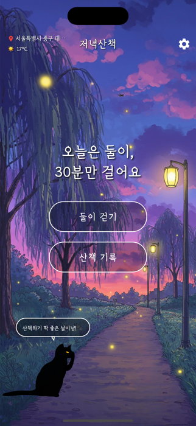
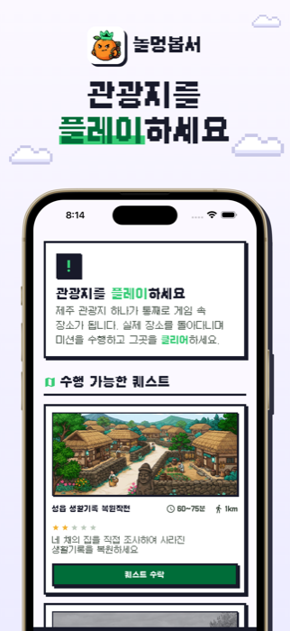

# 안녕하세요, 만드는 걸 좋아하는 **조익준**입니다. 

- SOPT 39기 기획 파트 · 앱잼 「루티」 PM
- KAIST OverEdge 1인 창업 프로그램 전국 100인 선발

 

## 🏆 만든 것들

<table>
<tr>
<td width="180" align="center"></td>
<td>

### [천명록](https://www.cheonmyeongrok.com) 🔮
**사주팔자 AI 해석 + 수호신 부적 디지털 굿즈**

생년월일만 넣으면 AI가 내 사주를 읽어 주듯 풀어 줍니다. 회원가입 없이 쓰고, KG이니시스 정식 가맹으로 **실제 결제를 받으며 운영 중**이에요.

   
 [🌐 서비스](https://www.cheonmyeongrok.com) · [📄 소개](https://github.com/keepdev0919/cheonmyeongrok-showcase)

</td>
</tr>

<tr>
<td width="180" align="center"></td>
<td>

### [저녁산책](https://apps.apple.com/kr/app/id6751829040) 🌙
**산책을 조금 더 재밌게 만드는 앱**

저녁 먹고 식곤증이 오면 자기 전까지 누워서 폰만 보게 되더라고요. 그걸 끊으려고 산책을 나가기 시작했는데, 다녀오면 확실히 리프레시가 됐어요. 그런데 매일 하다 보니 지루해져서 **산책 자체를 재밌게 만드는 앱**을 만들었습니다.

  
 [🍎 App Store](https://apps.apple.com/kr/app/id6751829040) · [▶️ Google Play](https://play.google.com/store/apps/details?id=com.ikjun.walk) · [📄 소개](https://github.com/keepdev0919/evening-walk-showcase)

</td>
</tr>

<tr>
<td width="180" align="center"></td>
<td>

### [놀멍봅서](https://github.com/keepdev0919/nolmeongbopseo) 🍊
**제주 관광지 하나가 통째로 게임 속 장소가 되는 iOS 앱**

졸업 프로젝트로 만든 제주 설화 기반 여행 앱이 **2026 관광데이터 활용 공모전** 예비심사를 통과하면서 서비스로 다시 키우고 있어요. 서비스로 다시 보니 설화는 억지로 넣은 부분이 많았습니다. 그래서 "관광지를 보고 나오는 곳이 아니라 **플레이하고 나오는 곳**"으로 피벗했어요.

  

</td>
</tr>

<tr>
<td width="180" align="center"><a href="https://github.com/keepdev0919/routee-mock"><h1>⛰️</h1>Routee Mock</a></td>
<td>

### [Routee Mock](https://github.com/keepdev0919/routee-mock) ⛰️
**등산 앱 QA를 책상 앞에서 끝내는 모의 위치 앱**

벤처창업동아리 **SOPT**에서 등산 서비스 **루티**의 PM을 맡고 있어요. 기능 하나 확인하려 해도 직접 나가서 걷고 사진을 찍어야 했고, QA 기간엔 정해진 시간 안에 같은 길을 계속 오가야 하는 불편함이 있었습니다. GPS 시뮬레이터 앱은 광고가 너무 많아 QA에 쓸 수 없었어요. 그래서 **루티 디자인에 맞춘 광고 없는 모의 위치 앱**을 직접 만들었습니다.

 
 [📦 APK 받기](https://github.com/keepdev0919/routee-mock/releases/latest)

</td>
</tr>

<tr>
<td width="180" align="center"></td>
<td>

### [StyleLens](https://stylelens.store) 👗
**사진 한 장으로 보는 AI 스타일리스트**

올해 2월, 조코딩의 「1인 사업 프로덕트 빌더」 강의를 들으면서 **한 달 만에 만든** 서비스예요. 퍼스널 컬러, 체형, 헤어, 코디를 분석해 리포트로 보내 줍니다.

  
 [🌐 서비스](https://stylelens.store) · [💻 코드](https://github.com/keepdev0919/StyleLens)

</td>
</tr>

<tr>
<td width="180" align="center"></td>
<td>

### [책상 동물원](https://github.com/keepdev0919/turtle-eye-slayer) 🐾
**한 시간마다 동물이 나타나 거북목과 눈을 챙겨 주는 맥 앱**

하루 대부분을 노트북 앞에서 보내다 보니 어느새 거북목이 되고, 눈을 깜빡이는 걸 잊어서 안구건조까지 왔어요. "한 시간마다 화면에 알림을 띄우자!"에서 시작해서, 귀여운 동물이 나타나 **눈 운동 하나, 목 운동 하나**를 알려 주는 앱이 됐습니다.

 

</td>
</tr>

<tr>
<td width="180" align="center"></td>
<td>

### 오늘할일 🗓️
**완료하면 젠슨 황이 칭찬해 주는 재미용 투두**

원래 맥 캘린더 앱을 깔아서 할일을 관리했는데, 폰이랑 연동이 안 되는 등 불편한 게 많았어요. 그래서 **맥 바탕화면과 폰에서 같이 쓰는 할일 앱**을 직접 만들었습니다. 맨 위에는 일할 때 힘이 되는 명언 한 줄이 뜨고, 할일을 끝내면 젠슨 황 · 일론 머스크 · 샘 올트먼 · 이재용이 튀어나와 한마디 던져요.

  

</td>
</tr>
</table>

 

## 🏅 수상 · 자격

- 🏆 **SOPT 앱잼 대상 · 사업성 우수상** (2026) — 등산 기록 앱 루티
- 🍊 **2026 관광데이터 활용 공모전** 예비심사 통과 — 놀멍봅서
- 📜 정보처리기사 · SQL 개발자(SQLD)

 

## 🎓 학력

- **경희대학교 컴퓨터공학과** 2027.02 졸업예정

 

## 🛠 주로 쓰는 것

          
